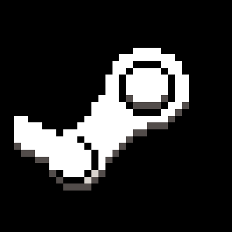
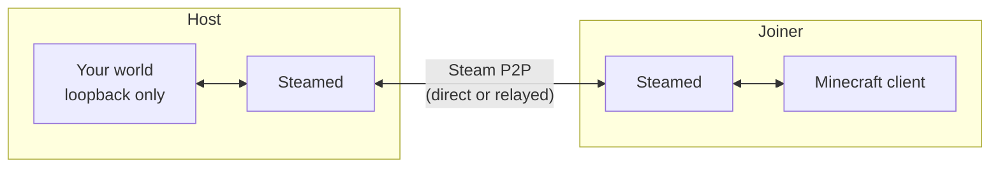

<div align="center">



# Steamed

**Host your Minecraft world through a Steam lobby and play with your Steam friends.**
No port forwarding, no third-party tunnels: connections go through Steam's own peer-to-peer relay.

<sub><i>Steam from the steamed craft we're having.</i></sub>


[](https://github.com/0x00ACAB/steamed/actions/workflows/build.yml)


</div>

## Quick start

1. Install Steamed (everyone who wants to play needs it) and make sure **Steam is running**
2. Load a world, open the pause menu and click **Steam Lobby**
3. Click **Create Lobby**, then **Invite** and pick a friend from the in-game friend list
4. Your friend clicks the orange mug next to **Multiplayer** on their title screen (or opens **Steam Lobby** from the
   pause menu) and clicks **Accept**, or **Join** next to your name

## Features

- **No port forwarding.** Works behind NAT, CGNAT and routers without UPnP. Steam connects you directly when it can and
  relays the traffic when it can't
- **Join friends without waiting for an invite.** The Steam Lobby screen lists the Steam friends hosting a world right
  now, with a Join button
- **Only the people you invite.** Lobbies are friends-only or invite-only. Every joiner proves who they are with a Steam
  auth ticket before they can reach your world, and your world isn't opened to your LAN while you host through Steam
- **Lobby management.** Kick players, leave the lobby, and everyone is disconnected cleanly when the host closes it
- **Voice chat comes along.** [Simple Voice Chat](https://modrinth.com/plugin/simple-voice-chat)
  and [Plasmo Voice](https://modrinth.com/plugin/plasmo-voice) are tunnelled over Steam too, with no extra setup
- **Web maps come along too.** If you run [BlueMap](https://modrinth.com/plugin/bluemap)
  or [squaremap](https://modrinth.com/plugin/squaremap), joiners get a chat link that opens your map through Steam
- **See who came in through Steam.** Players who joined through the Steam lobby get an orange diamond before their name
  tag, handy when Steam and LAN players share a world
- **Works without the Steam overlay.** Invites use an in-game friend picker, so they work even when the overlay doesn't
  show up in Minecraft

## How it works



When you create a lobby, Steamed opens your world on a local-only port and advertises your Steam ID in the lobby. A
friend who joins sends a Steam auth ticket over Steam's P2P network. Once Steam validates it, Steamed bridges their
connection to your world. To Minecraft on both sides it looks like an ordinary local connection.

## Requirements

|                          |                                                                                                      |
|--------------------------|------------------------------------------------------------------------------------------------------|
| **Minecraft**            | 26.2, Java 25                                                                                        |
| **Steam**                | The Steam client must be running and signed in, for everyone                                         |
| **Fabric**               | Fabric Loader 0.19.5+ and [Fabric Language Kotlin](https://modrinth.com/mod/fabric-language-kotlin)  |
| **NeoForge**             | NeoForge 26.2, nothing else (Kotlin is bundled)                                                      |
| **Quilt** (experimental) | Fabric Language Kotlin **1.13.14+kotlin.2.4.20**, unless you're on Quilt Loader 0.30.2 beta or newer |

Everyone in a lobby needs the same version of Steamed.

## Good to know

Steamed doesn't have its own Steam app yet, so it uses **Spacewar** (app ID 480), Valve's public test app:

- Your friends will see you as "playing Spacewar" while Minecraft is running with Steamed
- Steam's own "Invite to Game" / "Join Game" can't launch Minecraft for you. Use Steamed's in-game screens; if Minecraft
  is already running with Steamed, "Join Game" does work
- Lobbies are friends-only or invite-only, so other people on app 480 can't wander in

If you also use **e4mc** or **e4all**, they open a public tunnel to any world that gets published, including one hosted
through Steamed. Turn their hosting off if you only want Steam friends to join.

Steamed shares your Minecraft UUID with your Steam friends (as Steam rich presence and lobby data) so it can show player
heads. It remembers the UUIDs it has seen in `config/steamed-known-players.properties`.

squaremap defaults to port 8080, which the Steam client already uses on your machine. Change its web server port (for
example to 8081) or the map won't start.

On Linux (and with most launchers anywhere) the Steam overlay won't appear in Minecraft unless the launcher itself was
started from Steam. Steamed doesn't need it.

## Building

```sh
./gradlew build               # every loader
./gradlew :fabric:build       # or one at a time: :neoforge:build, :quilt:build
./gradlew :fabric:runClient   # dev client (Steam must be running), also :neoforge:runClient
```

Jars end up in `<loader>/build/libs/steamed-<loader>-<version>.jar`. The code lives almost entirely in `common/`, which
each loader module compiles in; see [`MILESTONES.md`](MILESTONES.md) for the roadmap and what has and hasn't been
tested.

## License

Steamed is released under [CC0-1.0](LICENSE). The jars bundle third-party libraries under their own licenses; see [
`THIRD_PARTY_NOTICES`](THIRD_PARTY_NOTICES). The icon is the "tea" glyph
from [Pixelarticons](https://github.com/halfmage/pixelarticons) (MIT), recoloured.

Steamed is not affiliated with or endorsed by Valve. Steam and Steamworks are trademarks of Valve Corporation.
